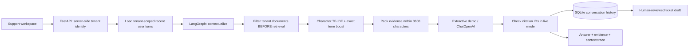

# FieldDesk Copilot

面向企业售后支持的 FDE 作品集项目：将虚构产品手册、客户配置和历史工单转换为可追溯的排查依据。

**FastAPI · LangGraph · LangChain OpenAI · Hybrid Retrieval · SQLite · Docker**

无需 API Key 即可运行演示。演示使用资料原文摘录，明确区别于真实 LLM 生成；配置模型后使用同一 LangGraph 流程生成回答。

## Quick start

Python 3.10+：

```bash
python -m venv .venv
# Windows: .venv\Scripts\activate
# macOS / Linux: source .venv/bin/activate
pip install -r requirements.txt
python -m uvicorn app.main:app --reload
```

打开 http://localhost:8000 ，API 文档位于 `/docs`。

也可运行 `docker compose up --build`。演示默认绑定本机，SQLite 数据保存在命名卷中。

试问“Atlas 出现 E101，应该怎么排查？”；切换 Acme / Nova 查看授权资料的差异；继续追问后生成工单草稿。

## Live model

通过终端导出环境变量（`.env.example` 仅为模板，不自动加载）：

```powershell
$env:MODEL_MODE="live"
$env:OPENAI_API_KEY="your-key"
$env:OPENAI_MODEL="gpt-4o-mini"
python -m uvicorn app.main:app
```

模型调用可能产生费用。模型编号可配置；请使用账号可访问的模型。正式部署替换 `ACME_API_KEY` / `NOVA_API_KEY`，同时修改前端身份入口；页面内置的 demo key 是公开演示凭据。不要将真实密钥提交到 Git。

## Architecture



检索采用字符 n-gram TF-IDF 与英文/错误码词项加分，适合中英文混合的小型演示。这里的 hybrid 指两种词法信号融合，**不包含语义向量检索或神经重排**。每个资料对象视作一个片段；当前没有文件上传或 PDF 解析。

上下文工程：保留最近三个用户问题，每条最多 300 字符；证据总长度最多 3600 字符；只将当前租户授权资料送入生成节点。字符预算不是精确 token 预算。历史不包含助手回复，也没有长期记忆。

## Verification

```bash
python -m pytest -q
python -m scripts.evaluate
```

测试覆盖：检索前权限过滤、未知问题拒答、引用、上下文预算、同名会话跨租户隔离、工单隔离和请求验证。8 条人工编写的合成检索用例只用于冒烟验证，不代表真实客户场景的准确率。

## FDE delivery materials

- [客户需求、验收标准与边界](docs/delivery.md)
- [API 使用示例](docs/api.md)
- 数据：`data/documents.json`，全部为原创虚构资料，不包含真实客户信息。
- CI：每次 push / PR 执行测试与检索评估。

## Limitations and next steps

这是可运行的作品集 MVP，不是生产认证系统。租户 key 仅为身份边界演示；生产需要 OIDC、用户级 ACL、速率限制、审计与数据保留策略。当前 SQLite 适合本地小规模运行，资料每次请求重新索引。关键词相似性阈值不保证问题可回答；引用编号校验也不能证明答案忠实于资料。模型输出需要人工核查。

可扩展方向：PDF ingestion、PostgreSQL/pgvector + BM25、reranker、精确 token 预算、Ragas 与人工标注评估，以及经人工批准的工单系统连接器。当前不会向外部工单系统提交内容。

## References

- [LangGraph Graph API](https://docs.langchain.com/oss/python/langgraph/graph-api)
- [RAG From Scratch](https://github.com/langchain-ai/rag-from-scratch)
- [Onyx](https://github.com/onyx-dot-app/onyx)

本项目独立编写；上述项目用于方向参考。

MIT License.
