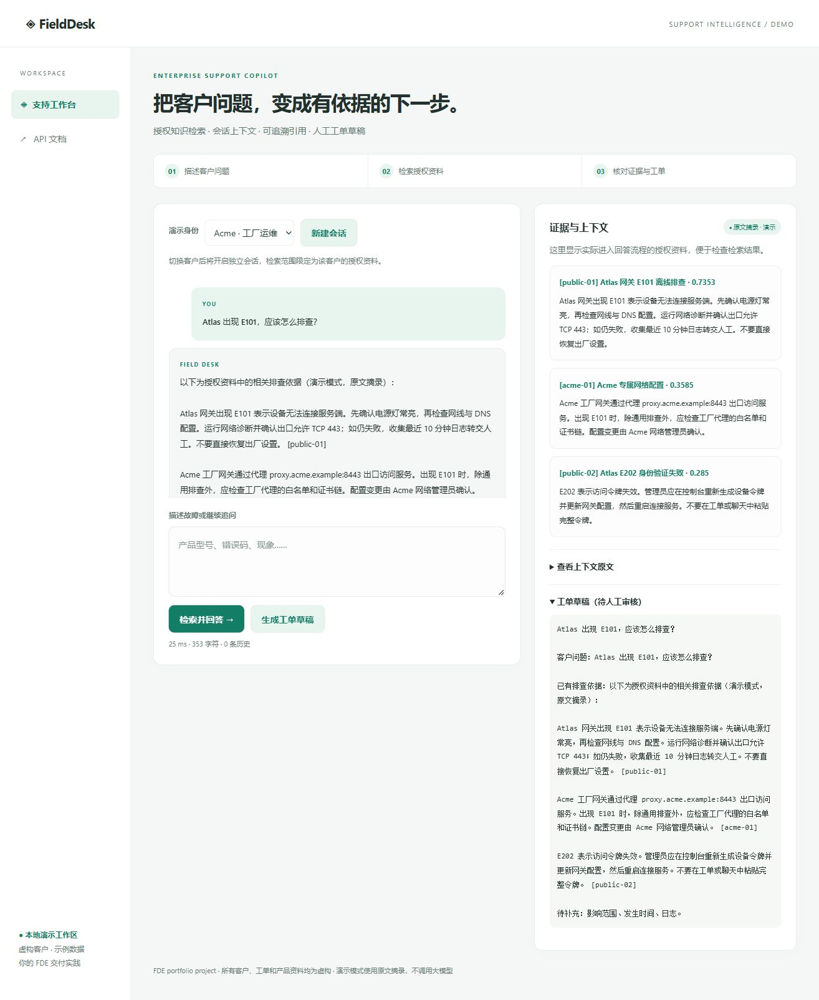

# FieldDesk 使用攻略

## 1. 安装与启动

安装 Python 3.10+ 和 Git，在终端执行：

```bash
git clone https://github.com/Suqs259/fielddesk-copilot.git
cd fielddesk-copilot
python -m venv .venv
```

Windows PowerShell 激活：`.venv\Scripts\Activate.ps1`；macOS / Linux：`source .venv/bin/activate`。如果 PowerShell 禁止脚本，可直接用 `.venv\Scripts\python.exe` 替代下面的 `python`，无需调整系统策略。

```bash
python -m pip install -r requirements.txt
python -m uvicorn app.main:app --host 127.0.0.1 --port 8000
```

打开 http://127.0.0.1:8000 。保持终端运行；结束时按 Ctrl+C。默认 demo 模式无需模型密钥。仓库页面仅展示代码和截图，不是在线应用。

## 2. 三分钟演示

1. 选择 **Acme · 工厂运维**，点击 **E101 · 网关离线**。快捷按钮只填入问题，随后点击 **检索并回答**。
2. 阅读回答，再对照右侧引用卡片。重点观察通用排查资料 `public-01` 和客户专属配置 `acme-01`。检索可能同时返回相似但不直接相关的资料，分数不是答案正确率。
3. 展开 **查看上下文原文**，查看实际交给生成节点的资料。
4. 点击 **生成工单草稿**，检查问题、已有排查依据与待补充信息。草稿不会发送至外部系统。
5. 切换 **Nova · 仓库运维**，再次询问同一故障，比较专线配置与 Acme 代理配置。切换身份会开启新会话。



## 3. 推荐问题

| 输入 | 观察重点 |
| --- | --- |
| Atlas 出现 E101，应该怎么排查？ | 通用文档与客户配置共同参与检索 |
| E202 令牌失效如何处理？ | 令牌更新与历史工单依据 |
| 固件升级失败，如何回滚？ | 升级前检查与回滚资料 |
| 数据上报延迟、队列积压怎么办？ | 数据队列排查 |
| zzzzqqqqxxxx | 无匹配资料时的补充信息提示 |

同一故障可继续追问；切换话题建议点击 **新建会话**，避免最近问题干扰检索。支持 Ctrl+Enter / Cmd+Enter 提交。

## 4. 如何解读页面

- **原文摘录 · 演示**：从检索结果摘录原文，不是大模型推理。
- **模型生成**：已进入配置的真实模型分支，仍需人工核对引用和结论。
- **字符 / 历史**：分别为当前证据长度和载入的最近用户问题数量，不是 token 数与完整会话长度。
- **引用分数**：词法相似性与词项加分，用于排序，不能当成置信概率。

## 5. 切换真实模型

PowerShell 中设置以下变量，然后重新启动服务：

```powershell
$env:MODEL_MODE="live"
$env:OPENAI_API_KEY="你的模型密钥"
$env:OPENAI_MODEL="gpt-4o-mini"
```

模型必须是账号可访问的型号，调用可能收费。`.env.example` 不会自动加载。恢复演示：设置 `$env:MODEL_MODE="demo"` 并重启。模型输出的引用编号会校验，但引用存在并不代表建议一定正确。

## 6. 常见问题

| 现象 | 处理 |
| --- | --- |
| 页面打不开 | 确认终端服务仍运行，并访问其显示的地址 |
| 8000 端口被占用 | 改为 `--port 8010`，访问相应地址 |
| 提示缺少模块 | 确认安装依赖与启动服务使用同一个虚拟环境 |
| 401 鉴权失败 | 页面内置 demo key 与后端自定义 key 不一致；自定义密钥需同步身份入口 |
| 502 模型调用失败 | 核对模型权限、密钥与网络；可切回 demo 排查 |
| 没有工单下载按钮 | 当前只展示草稿，可手动复制；尚未接入工单系统 |

## 7. 面试展示顺序

先说明客户售后资料分散的问题，再演示检索、引用、客户隔离和工单，最后介绍质量评估与限制。不要将合成数据的检索命中率说成生产准确率。运行 `python -m pytest -q` 与 `python -m scripts.evaluate` 可复现验证。
